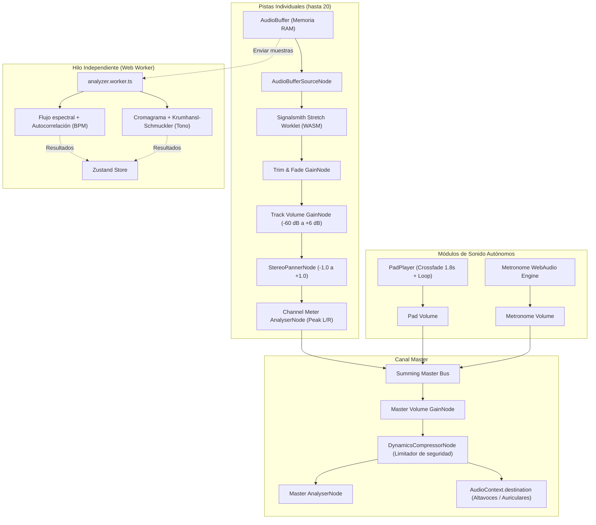

<p align="center">
  
</p>

<h1 align="center">OpenMT — Open Multitrack Audio Workstation</h1>

<p align="center">
  <strong>Estación de trabajo y reproductor de audio multipista profesional para directos, ensayos y producción.</strong><br />
  Disponible en versión web y como aplicación de escritorio nativa para Windows (.exe instalable y portable).
</p>

<p align="center">
  
  
  
  
  
  
  
  
</p>

<p align="center">
  <a href="https://github.com/edgardovalladares/OpenMT/releases/download/v2.1.0/OpenMT%20Setup%202.1.0.exe">
    
  </a>
  <a href="https://github.com/edgardovalladares/OpenMT/releases/download/v2.1.0/OpenMT%202.1.0.exe">
    
  </a>
</p>

---

## 📖 Tabla de Contenidos

1. [Acerca de OpenMT](#-acerca-de-openmt)
2. [Descargas y Versiones (.exe)](#-descargas-y-versiones-oficiales)
3. [Características Principales](#-características-principales)
   - [Motor Multipista Profesional](#-1-motor-multipista-profesional-hasta-20-pistas)
   - [Time-Stretch y Pitch-Shift con WASM](#-2-time-stretching-y-pitch-shifting-en-tiempo-real)
   - [Bloqueo de Tono por Pista (Pitch Lock)](#-3-bloqueo-de-tono-por-pista-pitch-lock)
   - [Pads Continuos Worship con Auto-Tonalidad](#-4-reproductor-de-pads-continuos-worship-ambient-pads)
   - [Metrónomo Profesional Integrado](#-5-metrónomo-profesional-integrado)
   - [Línea de Tiempo Continua e Infinita](#-6-línea-de-tiempo-continua-e-infinita-timeline)
   - [Secciones de Canción y Transiciones en Cola](#-7-secciones-de-canción-y-transiciones-en-cola-queued-jumps)
   - [Gestor de Repertorio / Setlist por Pestañas](#-8-gestor-de-repertorio--setlist-por-pestañas-en-vivo)
   - [Letras Sincronizadas (LRC), Código QR y OBS Studio](#-9-letras-sincronizadas-lrc-código-qr-y-salida-limpia-para-obs)
   - [Aplicación de Escritorio y Servidor LAN Local](#-10-aplicación-de-escritorio-electron-exe-y-servidor-lan-local-wifi-sin-internet)
   - [Recorte de Clips y Fundidos (Fade In / Out)](#-11-recorte-de-clips-y-desvanecimientos-fade-in--fade-out)
   - [Historial Deshacer y Rehacer](#-12-historial-de-deshacer-y-rehacer-undo--redo)
   - [Exportación Master (WAV y MP3)](#-13-exportación-de-audio-master-wav-y-mp3)
4. [Tecnologías Utilizadas](#-tecnologías-utilizadas)
5. [Arquitectura del Motor de Audio](#-arquitectura-del-motor-de-audio)
6. [Compatibilidad de Navegadores y Sistemas](#-compatibilidad-de-navegadores-y-sistemas)
7. [Instalación y Ejecución en Local](#-instalación-y-ejecución-en-local)
8. [Guía de Uso Paso a Paso](#-guía-de-uso-paso-a-paso)
9. [Atajos de Teclado](#-atajos-de-teclado)
10. [Estructura del Proyecto](#-estructura-del-proyecto)
11. [Privacidad y Seguridad](#-privacidad-y-seguridad)
12. [Licencia y Créditos](#-licencia-y-créditos)

---

## 🎯 Acerca de OpenMT

**OpenMT** es una estación de trabajo de audio digital multipista (*multitrack / stems player*) rápida, libre y sin suscripciones. Diseñada especialmente para músicos, iglesias, directores de alabanza, bandas en vivo y productores que requieren manipular secuencias, cambiar el tono, sincronizar tempos, disparar pads continuos, proyectar letras en vivo en pantallas y ensayar por secciones con latencia cero.

> [!IMPORTANT]
> **Privacidad Absoluta y Procesamiento Local:** Todos los archivos de audio se decodifican, procesan y reproducen localmente en tu equipo. Ninguna pista sale jamás a servidores externos ni requiere conexión a internet para sonar.

---

## 📦 Descargas y Versiones Oficiales

Puedes descargar los instaladores y binarios oficiales directamente desde la sección de **[Releases de GitHub](https://github.com/edgardovalladares/OpenMT/releases/tag/v2.1.0)**:

| Paquete | Archivo | Tamaño | Descripción |
| :--- | :--- | :---: | :--- |
| **Instalador Windows** | [`OpenMT Setup 2.1.0.exe`](https://github.com/edgardovalladares/OpenMT/releases/download/v2.1.0/OpenMT%20Setup%202.1.0.exe) | ~479 MB | Instalador completo con asistente NSIS, accesos directos y desinstalador. Incluye todos los pads worship offline y servidor LAN. |
| **Versión Portable** | [`OpenMT 2.1.0.exe`](https://github.com/edgardovalladares/OpenMT/releases/download/v2.1.0/OpenMT%202.1.0.exe) | ~479 MB | Ejecutable independiente de un solo clic. No requiere instalación ni permisos de administrador (ideal para llevar en memoria USB). |

---

## 🚀 Características Principales

### 🎚️ 1. Motor Multipista Profesional (hasta 20 pistas)
- **Capacidad ampliada:** Carga y reproduce de forma sincronizada hasta **20 pistas estéreo simultáneas**.
- **Soporte exhaustivo de formatos:** Compatible con `WAV`, `MP3`, `FLAC`, `OGG`, `M4A`, `AAC`, `Opus` y más.
- **Tira de canal completa por pista:**
  - Fader analógico calibrado de `-60 dB` a `+6 dB` con tope de ganancia unitaria en `0 dB` (doble clic para volver a 0 dB).
  - Control de balance estéreo (Pan `-100 % L` a `+100 % R`) con **efecto imán en el centro** (snapping magnético a `C`), indicador visual (`C`, `L50`, `R25`) y restablecimiento con **doble clic**.
  - Botones dedicados de **Mute (M)** y **Solo (S)** con lógica excluyente inteligente.
  - Vúmetros estéreo independientes (L/R) renderizados en `<canvas>` a **60 fps** con retención de pico (*peak-hold*) y advertencia de saturación (*clipping*).

### ⚡ 2. Time-Stretching y Pitch-Shifting en Tiempo Real
- Impulsado por el algoritmo **Signalsmith Stretch** compilado en **WebAssembly (WASM)** y ejecutado en un nodo de **AudioWorklet**.
- **Control de Tempo independiente:** Modifica la velocidad del 50 % al 200 % sin alterar la afinación musical.
- **Función Key Lock:** Alterna entre estiramiento temporal puro o simulación de velocidad variable tipo vinilo.
- **Corrección de octava:** Botones rápidos `÷2` y `×2` para compensar tempos detectados.
- **Transposición tonal:** Modifica el tono de `-12` a `+12 semitonos` con ajuste fino de microtonos de `-50` a `+50 cents`.
- **Rueda de Camelot integrada:** Visualiza y calcula la tonalidad resultante y su notación armónica (ej. `8B / C Mayor`).

### 🔒 3. Bloqueo de Tono por Pista (Pitch Lock)
- Permite seleccionar pistas específicas (como **batería**, **percusión**, **metrónomo/click** o **voz guía**) para **bloquearlas del cambio tonal general**.
- Al transponer la tonalidad maestra de la canción, las pistas bloqueadas permanecen en su afinación original para evitar artefactos o desafinaciones en elementos percusivos.
- Modal dedicado para gestionar rápidamente el bloqueo individual o por lotes.

### 🌊 4. Reproductor de Pads Continuos Worship (Ambient Pads)
- **2 Colecciones completas integradas:**
  - **Essentials:** Sonido cálido, acústico y orgánico.
  - **Omnisphere:** Sonido etéreo, profundo y envolvente para crear atmósfera de adoración.
- **Reproducción continua en bucle (`loop = true`):** El pad nunca se detiene; llena los vacíos entre canciones y transiciones.
- **Fundido cruzado suave (*crossfade*) de 1.8 segundos:** Al cambiar de tonalidad o de versión, la nota anterior se desvanece de manera imperceptible mientras la nueva entra con total naturalidad, libre de clics o cortes bruscos.
- **Auto-detección inteligente de tonalidad:** Sigue la tonalidad activa del DAW en tiempo real. Resuelve automáticamente tonalidades mayores y menores relativas (por ejemplo: si tu canción está en *Mi menor (Em)*, selecciona automáticamente el pad de *Sol (G)*; si está en *Si menor (Bm)*, selecciona el pad de *Re (D)*).
- **Matriz de 12 notas táctiles (C a B):** Acceso rápido para pulsar cualquier nota manualmente.
- Control de volumen independiente con deslizador continuo.

### ⏱️ 5. Metrónomo Profesional Integrado
- **Programador Web Audio de alta precisión (*lookahead* de 25 ms):** Cero desfases o pérdida de pulso.
- **Control de Tempo:** Rango de 30 a 300 BPM con ajuste fino de 1 en 1, pasos de 5 BPM y botón **TAP TEMPO** en tiempo real.
- **Selector de Compases / Métricas:** Soporta `4/4`, `3/4`, `2/4`, `6/8`, `5/4` y `7/8` con acentos dinámicos automáticos en el tiempo 1 y tiempos secundarios en métricas compuestas.
- **5 Sonidos sintetizados nativos (100 % offline):**
  - *Digital (Beep)*
  - *Madera (Clave / Woodblock)*
  - *Cencerro (808 Cowbell)*
  - *Aro (Rimshot)*
  - *Mecánico*
- **Luces de pulso en tiempo real (`metronome-dots`):** Indicadores visuales que parpadean al ritmo del compás con color destacado para el tiempo acentuado.
- **Control manual estricto:** El metrónomo solo sonará cuando tú decidas activarlo manualmente desde su botón de reproducción (no arrancará de sorpresa al dar Play al DAW).

### 📏 6. Línea de Tiempo Continua e Infinita (Timeline)
- **Margen de respiración extendido:** Añade espacio continuo al final de las pistas de audio para evitar que el clip o el cabezal se corten abruptamente contra el borde de la pantalla.
- **Sincronización subpíxel del cabezal (*Playhead*):** El marcador de reproducción se desplaza con exactitud a lo largo de todo el zoom horizontal, permaneciendo siempre en perfecta sincronía con el audio.
- Línea sutil de delimitación de pista y regla con marcas de tiempo continuas.

### 🔁 7. Secciones de Canción y Transiciones en Cola (*Queued Jumps*)
- **Detección inteligente de secciones:** Identifica nombres comunes en pistas guía o marcadores (`Intro`, `Verso 1`, `Coro`, `Puente`, `Solo`, `Outro`).
- **Modo Bucle por Sección:** Repite indefinidamente la sección seleccionada para ensayos específicos.
- **Transiciones en cola sin cortes:** Haz clic en otra sección durante la reproducción y OpenMT la colocará en cola con un indicador visual, realizando el cambio **al final exacto de la sección actual** para mantener el compás musical.
- Botón de salto inmediato opcional para transiciones directas.

### 🎶 8. Gestor de Repertorio / Setlist por Pestañas (En Vivo)
- **Múltiples canciones dentro del mismo proyecto:** Pestañas superiores para organizar tu repertorio en vivo (`Canción 1`, `Canción 2`, etc.).
- **Gestión fluida del concierto:** Añade canciones, renómbralas con doble clic, duplícalas, reordénalas o bórralas en cualquier momento.
- **Optimización extrema de memoria RAM y CPU:**
  - Al cambiar de pestaña, OpenMT desmonta y libera inmediatamente los grafos de nodos Web Audio y los procesos WASM de la canción inactiva, conservando sus buffers y configuración listos para un arranque instantáneo.
- **Persistencia en el archivo de proyecto:** Al guardar el proyecto `.openmt`, todas las canciones del repertorio con sus pistas, letras y ajustes se exportan conjuntamente.

### 🎤 9. Letras Sincronizadas (LRC), Código QR y Salida Limpia para OBS
- **Soporte de formato estándar LRC (.lrc / .txt):** Carga archivos de letra sincronizados o pégalos directamente con marcas de tiempo `[mm:ss.xx]`.
- **Enlace global único para todo el setlist:** Configuras OBS Studio o las pantallas una sola vez con tu sala persistente. Al cambiar de canción en OpenMT, las letras en OBS y celulares se actualizan automáticamente sin necesidad de tocar nada.
- **Protección de enlace (Candado Lock / Unlock):** Bloquea la sala de transmisión para prevenir cambios accidentales o regenera una nueva sala cuando lo decidas.
- **Generador de Código QR en vivo:** Muestra un código QR instantáneo para que vocalistas y músicos en el escenario apunten con la cámara de sus teléfonos o tablets.
- **Salida 100 % limpia sin fondos forzados:**
  - Los modos *Tercio inferior* y *Pantalla completa* no muestran recuadros ni guiones flotantes cuando no hay texto cantado o durante pausas instrumentales.
  - **4 Fondos seleccionables:** `Transparente` (nativo para fuentes navegador en OBS), `Oscuro elegante (#0b0d10)`, `Negro puro (#000000)` y `Croma verde (#00FF00)`.

### 🖥️ 10. Aplicación de Escritorio Electron (.exe) y Servidor LAN Local (WiFi sin Internet)
- **Versión nativa instalable y portable para Windows:** Empaquetado completo con Electron y electron-builder (`OpenMT Setup 2.1.0.exe` y versión portable).
- **Servidor LAN HTTP + SSE integrado:** En la aplicación de escritorio, OpenMT inicia su propio servidor local en el puerto `3000` y detecta tu IP de red local (ej. `http://192.168.1.X:3000`).
- **Acceso en red local para todo el equipo:** Cualquier teléfono, tablet o computadora conectada a la misma red Wi-Fi puede escanear el QR y ver el teleprompter en tiempo real durante ensayos o conciertos sin depender de conexión a internet.
- **Canal IPC nativo:** Comunicación bidireccional inmediata entre el renderizador y el servidor local en la versión de escritorio.

### ✂️ 11. Recorte de Clips y Desvanecimientos (Fade In / Fade Out)
- Edición no destructiva por pista con el editor de clips integrado.
- Ajuste de punto de inicio (*Start Offset*) y punto de final (*End Offset*).
- Desvanecimiento de entrada (*Fade In*) y desvanecimiento de salida (*Fade Out*) configurables en milisegundos con curvas lineales y visualización en la onda.

### ↩️ 12. Historial de Deshacer y Rehacer (Undo / Redo)
- Pila de historial integrada que registra cambios en faders, panorámicas, mutes, solos, tono, tempo, secciones y edición de clips.
- Atajos universales: `Ctrl + Z` (deshacer) y `Ctrl + Y` o `Ctrl + Shift + Z` (rehacer).

### 📤 13. Exportación de Audio Master (WAV y MP3)
- Renderizado fuera de línea acelerado (*offline render*) mediante `OfflineAudioContext`.
- Aplica fielmente todos los volúmenes, faders, panorámicas, silencios, time-stretch, transposición tonal, recortes y fundidos.
- **Formatos disponibles:**
  - **WAV:** Calidades PCM de 16 bits, 24 bits o 32 bits en coma flotante; frecuencia de muestreo de 44.1 kHz o 48 kHz.
  - **MP3:** Codificación local de alta velocidad con `@breezystack/lamejs` con tasas de bits seleccionables (128 kbps, 192 kbps, 256 kbps o 320 kbps).

---

## 💻 Tecnologías Utilizadas

| Categoría | Tecnología / Librería | Versión | Propósito |
| :--- | :--- | :--- | :--- |
| **Núcleo UI** | [React](https://react.dev/) | `^19.3.1` | Biblioteca de interfaz reactiva y componentes modulares |
| **Lenguaje** | [TypeScript](https://www.typescriptlang.org/) | `~7.0.2` | Tipado estricto en toda la lógica de audio y UI |
| **Empaquetador** | [Vite](https://vitejs.dev/) | `^8.3.4` | Servidor de desarrollo ultrarrápido y construcción optimizada |
| **Estado Global** | [Zustand](https://zustand-demo.pmnd.rs/) | `^5.0.15` | Gestión de estado predecible, reactiva y de alto rendimiento |
| **Motor DSP** | [Signalsmith Stretch](https://signalsmith-audio.co.uk/code/stretch/) | `^1.3.2` | Time-stretching y pitch-shifting polifónico vía WebAssembly |
| **Audio Nativo** | [Web Audio API](https://developer.mozilla.org/es/docs/Web/API/Web_Audio_API) | Nativa | Grafo de nodos de audio, AudioWorklet y procesamiento estéreo |
| **Procesamiento Hilos**| [Web Workers](https://developer.mozilla.org/es/docs/Web/API/Web_Workers_API) | Nativa | Detección de BPM (autocorrelación) y tono (Krumhansl) en background |
| **Render Offline** | `OfflineAudioContext` | Nativa | Renderizado de exportación multipista a velocidad de CPU |
| **Codificación MP3** | [@breezystack/lamejs](https://github.com/breezystack/lamejs) | `^1.2.7` | Codificador MP3 puro en JavaScript/TypeScript sin servidores |
| **Iconografía** | [Lucide React](https://lucide.dev/) | `^1.59.0` | Íconos limpios en SVG (cero emojis) |
| **Códigos QR** | [QRCode](https://github.com/soldair/node-qrcode) | `^1.5.4` | Generador instantáneo de códigos QR para teléfonos y tablets |
| **Escritorio** | [Electron](https://www.electronjs.org/) | `^41.3.1` | Aplicación de escritorio multiplataforma con servidor LAN HTTP + SSE |
| **Empaquetado .exe** | [electron-builder](https://www.electron.build/) | `^26.0.2` | Compilador de instaladores NSIS y portables para Windows x64 |
| **Tipografía** | [@fontsource/figtree](https://fontsource.org/fonts/figtree) | `^5.3.0` | Fuente Figtree empaquetada localmente (100 % libre de CDN) |
| **Testing** | [Vitest](https://vitest.dev/) | `^5.0.5` | Pruebas unitarias de matemáticas de dB, música, estado y pads |
| **Linter** | [Oxlint](https://oxc.rs/) | `^1.88.0` | Análisis estático de código ultra veloz en Rust |

---

## 🔊 Arquitectura del Motor de Audio



---

## 🌐 Compatibilidad de Navegadores y Sistemas

| Plataforma | Soporte | Notas |
| :--- | :---: | :--- |
| **Windows 10 / 11 (.exe)** |  Nativo | Instalador y versión portable disponibles con servidor LAN Wi-Fi integrado |
| **Google Chrome / Microsoft Edge** |  Total | Máximo rendimiento con soporte nativo de WASM SIMD y AudioWorklet |
| **Mozilla Firefox** |  Total | Soporte nativo completo para AudioWorklet |
| **Apple Safari (macOS / iPadOS / iOS)** |  Total | Compatible a partir de Safari 15.4+ |
| **Navegadores Móviles (Android / iOS)** |  Compatible | Requiere un toque inicial del usuario para reanudar el contexto de audio |

---

## 🛠️ Instalación y Ejecución en Local

### Prerrequisitos
- [Node.js](https://nodejs.org/) versión **18.0.0** o superior (recomendado 20+ LTS).
- Administrador de paquetes `npm` (incluido con Node.js), `pnpm` o `yarn`.

### 1. Clonar el repositorio
```bash
git clone https://github.com/edgardovalladares/OpenMT.git
cd OpenMT
```

### 2. Instalar dependencias
```bash
npm install
```

### 3. Iniciar el servidor de desarrollo web
```bash
npm run dev
```
Abre tu navegador en [http://localhost:5173/](http://localhost:5173/).

### 4. Ejecutar pruebas unitarias
```bash
npm test
```

### 5. Compilar para escritorio Windows (.exe)
```bash
npm run dist:exe
```
Los archivos `.exe` (instalador NSIS y versión portable) se generarán en la carpeta `release/`.

---

## 🧭 Guía de Uso Paso a Paso

1. **Importar Pistas:** Arrastra archivos de audio directamente al centro de la aplicación o haz clic en el botón **`+`** de transporte.
2. **Control del Transporte:** Presiona **Espacio** para reproducir/pausar. Haz clic en la regla de tiempo para mover el cabezal.
3. **Pads Continuos:** Pulsa el botón de reproducción en el panel **PADS WORSHIP** de la barra superior. Si la casilla de Auto-Tonalidad está activa, el pad cambiará de nota automáticamente cuando cambies de canción o tono.
4. **Metrónomo:** Activa el metrónomo desde la barra superior. Ajusta el tempo con los botones `+`/`-`, usa **TAP TEMPO** o selecciona la métrica rítmica (`4/4`, `3/4`, `6/8`, etc.).
5. **Transposición y Tempo:** Cambia la velocidad del 50 % al 200 % o transpón en semitonos. Bloquea pistas rítmicas con el candado.
6. **Setlist de Canciones:** Añade nuevas canciones en las pestañas superiores para tener todo tu repertorio listo para el concierto.
7. **Proyección de Letras:** Abre el panel **LETRAS** para cargar archivos `.lrc`, copiar el enlace limpio para OBS Studio o escanear el código QR con teléfonos o tablets.

---

## ⌨️ Atajos de Teclado

| Atajo | Acción |
| :--- | :--- |
| <kbd>Espacio</kbd> | Reproducir / Pausar la mezcla |
| <kbd>Inicio</kbd> / <kbd>Home</kbd> | Volver al inicio de la pista (tiempo `0:00.0`) |
| <kbd>Ctrl</kbd> + <kbd>Z</kbd> | Deshacer la última acción |
| <kbd>Ctrl</kbd> + <kbd>Y</kbd> / <kbd>Ctrl</kbd> + <kbd>Shift</kbd> + <kbd>Z</kbd> | Rehacer la acción |
| <kbd>Ctrl</kbd> + <kbd>Rueda del ratón</kbd> | Acercar o alejar el zoom horizontal del timeline |
| <kbd>Alt</kbd> + <kbd>Rueda del ratón</kbd> | Acercar o alejar el zoom horizontal del timeline |
| <kbd>Doble Clic</kbd> en Faders / Pan | Restablecer valor a su posición por defecto (`0 dB`, `Centro (C)`) |
| <kbd>Escape</kbd> | Cerrar cualquier modal o menú desplegable abierto |

---

## 📁 Estructura del Proyecto

```plaintext
daw-mt/
├── electron/
│   ├── main.cjs               # Proceso principal de Electron y Servidor LAN (HTTP + SSE)
│   └── preload.cjs            # Canal IPC bidireccional seguro (contextBridge)
├── public/
│   ├── images/
│   │   ├── favicon.png        # Favicon oficial
│   │   ├── logo-dark.png      # Logo oficial para modo oscuro
│   │   └── logo-light.png     # Logo oficial para modo claro
│   └── pads/                  # Librerías de pads continuos worship
│       ├── ESSENTIALS/        # 12 tonalidades acústicas y cálidas
│       └── OMNISPHERE/        # 12 tonalidades etéreas y atmosféricas
├── release/                   # Ejecutables compilados de Windows (.exe)
├── src/
│   ├── audio/
│   │   ├── analysis/          # Web Worker para detección de BPM y Tono
│   │   ├── export/            # Render offline en WAV y MP3 con LameJS
│   │   ├── dbMath.ts          # Faders analógicos y curvas logarítmicas
│   │   ├── engine.ts          # Motor maestro de audio (Web Audio API)
│   │   ├── lyricsSync.ts      # Sincronización WebRTC, IPC y LAN de letras
│   │   ├── metronome.ts       # Motor del metrónomo con Web Audio nativo
│   │   ├── padPlayer.ts       # Motor de pads continuos y crossfade
│   │   └── track.ts           # Nodo individual de procesamiento por pista
│   ├── components/
│   │   ├── KeyPanel.tsx       # Tonalidad y Pitch Lock
│   │   ├── Lane.tsx           # Pistas visuales en el timeline
│   │   ├── LyricsModal.tsx    # Modal de configuración de letras, QR y OBS
│   │   ├── LyricsView.tsx     # Visor de teleprompter y salida limpia para OBS
│   │   ├── MetronomePanel.tsx # Panel de control del metrónomo
│   │   ├── PadPanel.tsx       # Panel de control de pads worship
│   │   ├── Ruler.tsx          # Regla de tiempo continua
│   │   ├── SongCards.tsx      # Pestañas de canciones del repertorio
│   │   ├── Stage.tsx          # Contenedor principal del timeline y zoom
│   │   └── TopBar.tsx         # Barra superior de transporte e instrumentos
│   ├── store/
│   │   └── useDaw.ts          # Estado global Zustand con optimización de memoria
│   ├── styles/
│   │   ├── app.css            # Estilos globales y diseño responsivo
│   │   └── tokens.css         # Variables y paletas de temas (Live Dark, Light, Neon)
│   ├── App.tsx                # Enrutador principal (DAW / Visor de letras)
│   └── main.tsx               # Montaje React 19
├── package.json
└── vite.config.ts
```

---

## 🔒 Privacidad y Seguridad

OpenMT está diseñado bajo la filosofía **Zero-Knowledge / Privacy-First**:
- **Sin cuentas ni registros:** Puedes usar la aplicación completa sin registrarte ni entregar correos electrónicos.
- **Sin telemetría ni rastreadores:** No se incluyen scripts de analíticas ni bibliotecas de terceros que espíen tus sesiones.
- **Cabeceras de Seguridad CSP:** El archivo `vercel.json` implementa políticas estrictas de seguridad de contenido (`Content-Security-Policy`):
  ```http
  Content-Security-Policy: default-src 'self'; script-src 'self' 'wasm-unsafe-eval' blob:; worker-src 'self' blob:; media-src 'self' blob: data:;
  ```

---

## 📄 Licencia y Créditos

Este proyecto es de código abierto bajo la licencia MIT.

### Reconocimientos especiales:
- **[Signalsmith Audio](https://signalsmith-audio.co.uk/):** Por el excepcional algoritmo de estiramiento de audio y cambio de tono [Signalsmith Stretch](https://github.com/Signalsmith-Audio/signalsmith-stretch).
- **[Lucide Icons](https://lucide.dev/):** Por el completo set de íconos vectoriales.
- **[LameJS](https://github.com/breezystack/lamejs):** Por la implementación de codificación MP3 en JavaScript.
- **[Google Fonts / Fontsource](https://fontsource.org/):** Por la tipografía Figtree.

---

<p align="center">
  Desarrollado con dedicación para músicos, iglesias y productores. Si encuentras útil este proyecto, ¡no olvides dejar una ⭐ en <a href="https://github.com/edgardovalladares/OpenMT">GitHub</a>!
</p>
