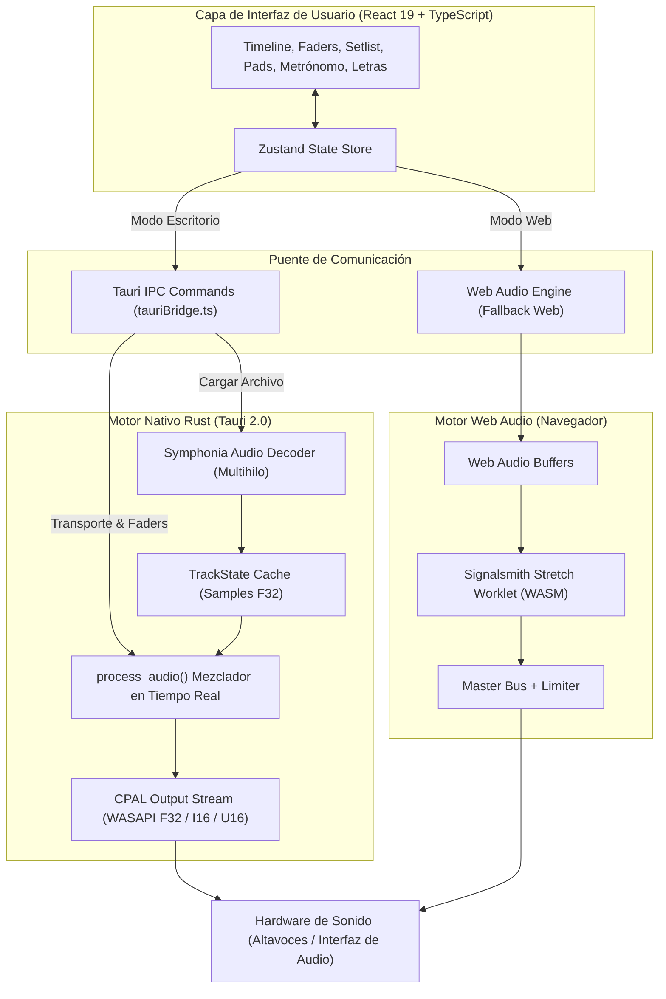

<p align="center">
  
</p>

<h1 align="center">OpenMT — Open Multitrack Audio Workstation</h1>

<p align="center">
  <strong>Estación de trabajo y reproductor de audio multipista profesional para directos, ensayos y producción.</strong><br />
  Impulsado por una arquitectura nativa de alto rendimiento en <strong>Tauri 2.0 + Rust</strong> para escritorio y <strong>Web Audio / WASM</strong> en navegador.
</p>

<p align="center">
  
  
  
  
  
  
  
  
  
</p>

<p align="center">
  <a href="https://github.com/edgardovalladares/OpenMT/releases/download/v3.2.1/OpenMT_3.2.1_x64-setup.exe">
    
  </a>
  <a href="https://github.com/edgardovalladares/OpenMT/releases/download/v3.2.1/OpenMT_3.2.1_x64_Portable.exe">
    
  </a>
  <a href="https://github.com/edgardovalladares/OpenMT/releases/download/v3.2.1/OpenMT_3.2.1_x64_en-US.msi">
    
  </a>
</p>

---

## 📖 Tabla de Contenidos

1. [Acerca de OpenMT](#-acerca-de-openmt)
2. [Novedades de la Versión 3.2.1](#-novedades-de-la-versión-321)
3. [Descargas y Versiones Oficiales](#-descargas-y-versiones-oficiales)
4. [Características Principales](#-características-principales)
   - [Motor Nativo de Audio Multihilo (Rust)](#-1-motor-nativo-de-audio-multihilo-rust--cpal--symphonia)
   - [Time-Stretch y Pitch-Shift con WASM](#-2-time-stretching-y-pitch-shifting-en-tiempo-real)
   - [Bloqueo de Tono por Pista (Pitch Lock)](#-3-bloqueo-de-tono-por-pista-pitch-lock)
   - [Pads Continuos Worship con Auto-Tonalidad](#-4-reproductor-de-pads-continuos-worship-ambient-pads)
   - [Metrónomo Profesional Integrado](#-5-metrónomo-profesional-integrado)
   - [Línea de Tiempo Continua e Infinita](#-6-línea-de-tiempo-continua-e-infinita-timeline)
   - [Secciones de Canción y Transiciones en Cola](#-7-secciones-de-canción-y-transiciones-en-cola-queued-jumps)
   - [Gestor de Repertorio / Setlist Ilimitado](#-8-gestor-de-repertorio--setlist-ilimitado-en-vivo)
   - [Letras Sincronizadas (LRC), Código QR y OBS Studio](#-9-letras-sincronizadas-lrc-código-qr-y-salida-limpia-para-obs)
   - [Servidor LAN Local y Proyección Inalámbrica](#-10-servidor-lan-local-y-proyección-inalámbrica-wifi-sin-internet)
   - [Recorte de Clips y Fundidos (Fade In / Out)](#-11-recorte-de-clips-y-desvanecimientos-fade-in--fade-out)
   - [Historial Deshacer y Rehacer](#-12-historial-de-deshacer-y-rehacer-undo--redo)
   - [Exportación Master (WAV y MP3)](#-13-exportación-de-audio-master-wav-y-mp3)
5. [Tecnologías y Stack Técnico](#-tecnologías-y-stack-técnico)
6. [Arquitectura del Sistema](#-arquitectura-del-sistema)
7. [Requisitos y Compatibilidad](#-requisitos-y-compatibilidad)
8. [Instalación y Desarrollo Local](#-instalación-y-desarrollo-local)
9. [Atajos de Teclado](#-atajos-de-teclado)
10. [Estructura del Proyecto](#-estructura-del-proyecto)
11. [Privacidad y Seguridad](#-privacidad-y-seguridad)
12. [Licencia y Créditos](#-licencia-y-créditos)

---

## 🎯 Acerca de OpenMT

**OpenMT** es una estación de trabajo de audio digital multipista (*multitrack / stems player*) rápida, libre, de código abierto y sin suscripciones. Diseñada especialmente para músicos, directores de alabanza, bandas en vivo, iglesias y productores que requieren reproducir secuencias multipista, cambiar el tono al instante, sincronizar tempos, disparar pads continuos, proyectar letras en vivo en pantallas y ensayar por secciones con latencia cero.

> [!IMPORTANT]
> **Privacidad Absoluta y Procesamiento Local:** Todos los archivos de audio se decodifican, procesan y reproducen localmente en tu equipo. Ninguna pista sale jamás a servidores externos ni requiere conexión a internet para sonar.

---

## ⚡ Novedades de la Versión 3.2.1

La versión 3.2.1 perfecciona la salida limpia de letras en vivo y la sincronización fidedigna de estilos en tiempo real:

- **Salida Limpia para OBS Studio y Pantallas de Proyección:**
  - Eliminación total de encabezados, títulos de proyecto y badges de estado (`"LAN WiFi en vivo"`, `"OpenMT Live"`) en las vistas de letras para transmisión y proyección.
  - En modo transparente (`transparent`), fondo 100% libre de bordes, placas o tarjetas de espera residuales para superponer limpiamente sobre cámaras y transmisiones de video.
- **Sincronización Dinámica de Estilos en Tiempo Real:**
  - Aplicación estricta de las opciones activas configuradas por el usuario: Temas (`transparent`, `dark`, `black`, `chroma-green`), Modos (`lowerthird`, `fullscreen`, `prompter`), Tamaños de fuente (`normal`, `large`, `xlarge`), Mayúsculas y Ocultar siguiente línea.
  - El servidor LAN autónomo actualiza instantáneamente en caliente las pantallas remotas, tablets y fuentes de navegador de OBS en cuanto el usuario ajusta el diseño en OpenMT, sin necesidad de recargar.
  - Corrección de enlaces y códigos QR en red local Wi-Fi para direccionamiento inmediato a la IP del equipo anfitrión.
  - Persistencia de opciones de diseño de letras en almacenamiento local.

---

## ⚡ Novedades de la Versión 3.2.0

La versión 3.2.0 introdujo mejoras clave en experiencia visual, edición interactiva y organización del espacio de trabajo:

- **Esqueleto y Precargador Animado de Pistas (Track Skeletons):** Inserción por lotes instantánea en 0 ms con silueta animada.
- **Secciones Musicales con Altura, Anchura y Posición Editables:** Tiradores para duración, movimiento temporal y altura graduable (26px a 90px).
- **Reorganización del Setlist (Arriba junto a Letras):** Fila horizontal compacta con desplazamiento suave y modal bajo demanda.

---

## 📦 Descargas y Versiones Oficiales

Puedes descargar los paquetes oficiales directamente desde la sección de **[Releases de GitHub (v3.2.1)](https://github.com/edgardovalladares/OpenMT/releases/tag/v3.2.1)**:

| Paquete | Archivo | Tamaño | Descripción |
| :--- | :--- | :---: | :--- |
| **Instalador Windows** | [`OpenMT_3.2.1_x64-setup.exe`](https://github.com/edgardovalladares/OpenMT/releases/download/v3.2.1/OpenMT_3.2.1_x64-setup.exe) | ~375 MB | **Recomendado:** Instalador con asistente NSIS, accesos directos en inicio/escritorio y desinstalador limpio. |
| **Versión Portable** | [`OpenMT_3.2.1_x64_Portable.exe`](https://github.com/edgardovalladares/OpenMT/releases/download/v3.2.1/OpenMT_3.2.1_x64_Portable.exe) | ~378 MB | Ejecutable independiente de un solo clic. No requiere instalación ni permisos de administrador (ideal para llevar en memoria USB). |
| **Instalador MSI** | [`OpenMT_3.2.1_x64_en-US.msi`](https://github.com/edgardovalladares/OpenMT/releases/download/v3.2.1/OpenMT_3.2.1_x64_en-US.msi) | ~372 MB | Paquete Windows Installer MSI estándar para instalaciones corporativas o despliegues automatizados. |

---

## 🚀 Características Principales

### 🎚️ 1. Motor Nativo de Audio Multihilo (Rust + CPAL + Symphonia)
- **Capacidad ampliada:** Carga y reproduce de forma sincronizada hasta **20 pistas estéreo simultáneas** por canción con docenas de canciones en el repertorio.
- **Soporte exhaustivo de formatos:** Compatible con `WAV`, `MP3`, `FLAC`, `OGG`, `M4A`, `AAC`, `Opus` y más.
- **Tira de canal completa por pista:**
  - Fader analógico calibrado de `-60 dB` a `+6 dB` con tope de ganancia unitaria en `0 dB` (doble clic para volver a 0 dB).
  - Control de balance estéreo (Pan `-100 % L` a `+100 % R`) con **efecto imán en el centro** (snapping magnético a `C`), indicador visual (`C`, `L50`, `R25`) y restablecimiento con **doble clic**.
  - Botones dedicados de **Mute (M)** y **Solo (S)** con lógica excluyente inteligente.
  - Vúmetros estéreo independientes (L/R) a **60 fps** con retención de pico (*peak-hold*) y advertencia de saturación (*clipping*).

### ⚡ 2. Time-Stretching y Pitch-Shifting en Tiempo Real
- Algoritmo **Signalsmith Stretch** polifónico de alta fidelidad compilado en **WebAssembly (WASM)**.
- **Control de Tempo independiente:** Modifica la velocidad del 50 % al 200 % sin alterar la afinación musical.
- **Función Key Lock:** Alterna entre estiramiento temporal puro o simulación de velocidad variable tipo vinilo.
- **Corrección de octava:** Botones rápidos `÷2` y `×2` para compensar tempos detectados.
- **Transposición tonal:** Modifica el tono de `-12` a `+12 semitonos` con ajuste fino de microtonos de `-50` a `+50 cents`.
- **Rueda de Camelot integrada:** Visualiza y calcula la tonalidad resultante y su notación armónica (ej. `8B / C Mayor`).

### 🔒 3. Bloqueo de Tono por Pista (Pitch Lock)
- Permite seleccionar pistas específicas (como **batería**, **percusión**, **metrónomo/click** o **voz guía**) para **bloquearlas del cambio tonal general**.
- Al transponer la tonalidad maestra de la canción, las pistas bloqueadas permanecen en su afinación original para evitar artefactos o desafinaciones en elementos percusivos.
- Modal dedicado para gestionar rápidamente el bloqueo individual o por lotes.

### 🌊 4. Reproductor de Pads Continuos Worship (Ambient Pads)
- **2 Colecciones completas integradas:**
  - **Essentials:** Sonido cálido, acústico y orgánico.
  - **Omnisphere:** Sonido etéreo, profundo y envolvente para crear atmósfera de adoración.
- **Reproducción continua en bucle (`loop = true`):** El pad nunca se detiene; llena los vacíos entre canciones y transiciones.
- **Fundido cruzado suave (*crossfade*) de 1.8 segundos:** Al cambiar de tonalidad o de versión, la nota anterior se desvanece de manera imperceptible mientras la nueva entra con total naturalidad, libre de clics o cortes bruscos.
- **Auto-detección inteligente de tonalidad:** Sigue la tonalidad activa del DAW en tiempo real. Resuelve automáticamente tonalidades mayores y menores relativas (por ejemplo: si tu canción está en *Mi menor (Em)*, selecciona automáticamente el pad de *Sol (G)*; si está en *Si menor (Bm)*, selecciona el pad de *Re (D)*).
- **Matriz de 12 notas táctiles (C a B):** Acceso rápido para pulsar cualquier nota manualmente.
- Control de volumen independiente con deslizador continuo.

### ⏱️ 5. Metrónomo Profesional Integrado
- **Programador de alta precisión (*lookahead* de 25 ms):** Cero desfases o pérdida de pulso.
- **Control de Tempo:** Rango de 30 a 300 BPM con ajuste fino de 1 en 1, pasos de 5 BPM y botón **TAP TEMPO** en tiempo real.
- **Selector de Compases / Métricas:** Soporta `4/4`, `3/4`, `2/4`, `6/8`, `5/4` y `7/8` con acentos dinámicos automáticos en el tiempo 1 y tiempos secundarios en métricas compuestas.
- **5 Sonidos sintetizados nativos (100 % offline):**
  - *Digital (Beep)*
  - *Madera (Clave / Woodblock)*
  - *Cencerro (808 Cowbell)*
  - *Aro (Rimshot)*
  - *Mecánico*
- **Luces de pulso en tiempo real (`metronome-dots`):** Indicadores visuales que parpadean al ritmo del compás con color destacado para el tiempo acentuado.
- **Control manual estricto:** El metrónomo solo sonará cuando tú decidas activarlo manualmente desde su botón de reproducción.

### 📏 6. Línea de Tiempo Continua e Infinita (Timeline)
- **Margen de respiración extendido:** Espacio continuo al final de las pistas de audio para evitar que el clip o el cabezal se corten abruptamente contra el borde de la pantalla.
- **Sincronización subpíxel del cabezal (*Playhead*):** El marcador de reproducción se desplaza con exactitud a lo largo de todo el zoom horizontal, permaneciendo siempre en perfecta sincronía con el audio.
- Regla con marcas de tiempo continuas y línea sutil de delimitación de pista.

### 🔁 7. Secciones de Canción y Transiciones en Cola (*Queued Jumps*)
- **Detección inteligente de secciones:** Identifica nombres comunes en pistas guía o marcadores (`Intro`, `Verso 1`, `Coro`, `Puente`, `Solo`, `Outro`).
- **Modo Bucle por Sección:** Repite indefinidamente la sección seleccionada para ensayos específicos.
- **Transiciones en cola sin cortes:** Haz clic en otra sección durante la reproducción y OpenMT la colocará en cola con un indicador visual, realizando el cambio **al final exacto de la sección actual** para mantener el compás musical.
- Botón de salto inmediato opcional para transiciones directas.

### 🎶 8. Gestor de Repertorio / Setlist Ilimitado (En Vivo)
- **Múltiples canciones dentro del mismo proyecto:** Pestañas superiores para organizar tu repertorio en vivo (`Canción 1`, `Canción 2`, etc.).
- **Gestión fluida del concierto:** Añade canciones, renómbralas con doble clic, duplícalas, reordénalas o bórralas en cualquier momento.
- **Aislamiento de audio y eficiencia:** Al cambiar de pestaña, OpenMT conmuta el motor de audio instantáneamente, manteniendo en caché los metadatos y formas de onda sin sobrecargar la CPU.
- **Persistencia en el archivo de proyecto:** Al guardar el proyecto `.openmt`, todas las canciones del repertorio con sus pistas, letras y ajustes se exportan conjuntamente.

### 🎤 9. Letras Sincronizadas (LRC), Código QR y Salida Limpia para OBS
- **Soporte de formato estándar LRC (.lrc / .txt):** Carga archivos de letra sincronizados o pégalos directamente con marcas de tiempo `[mm:ss.xx]`.
- **Enlace global único para todo el setlist:** Configuras OBS Studio o las pantallas una sola vez. Al cambiar de canción en OpenMT, las letras en OBS y celulares se actualizan automáticamente sin necesidad de tocar nada.
- **Protección de enlace (Candado Lock / Unlock):** Bloquea la sala de transmisión para prevenir cambios accidentales o regenera una nueva sala cuando lo decidas.
- **Generador de Código QR en vivo:** Muestra un código QR instantáneo para que vocalistas y músicos en el escenario apunten con la cámara de sus teléfonos o tablets.
- **Salida 100 % limpia sin fondos forzados:**
  - Los modos *Tercio inferior* y *Pantalla completa* no muestran recuadros ni guiones flotantes cuando no hay texto cantado o durante pausas instrumentales.
  - **4 Fondos seleccionables:** `Transparente` (nativo para fuentes navegador en OBS), `Oscuro elegante (#0b0d10)`, `Negro puro (#000000)` y `Croma verde (#00FF00)`.

### 📡 10. Servidor LAN Local y Proyección Inalámbrica (WiFi sin Internet)
- En la aplicación de escritorio, OpenMT inicia su propio servidor local en el puerto `3000` y detecta automáticamente tu IP de red local (ej. `http://192.168.1.X:3000`).
- **Acceso en red local para todo el equipo:** Cualquier teléfono, tablet o computadora conectada a la misma red Wi-Fi puede escanear el QR y ver el teleprompter en tiempo real durante ensayos o conciertos sin depender de conexión a internet.

### ✂️ 11. Recorte de Clips y Desvanecimientos (Fade In / Fade Out)
- Edición no destructiva por pista con el editor de clips integrado.
- Ajuste de punto de inicio (*Start Offset*) y punto de final (*End Offset*).
- Desvanecimiento de entrada (*Fade In*) y desvanecimiento de salida (*Fade Out*) configurables en milisegundos con curvas lineales y visualización en la onda.

### ↩️ 12. Historial de Deshacer y Rehacer (Undo / Redo)
- Pila de historial integrada que registra cambios en faders, panorámicas, mutes, solos, tono, tempo, secciones y edición de clips.
- Atajos universales: `Ctrl + Z` (deshacer) y `Ctrl + Y` o `Ctrl + Shift + Z` (rehacer).

### 📤 13. Exportación de Audio Master (WAV y MP3)
- Renderizado fuera de línea acelerado (*offline render*) de alta velocidad.
- Aplica fielmente todos los volúmenes, faders, panorámicas, silencios, time-stretch, transposición tonal, recortes y fundidos.
- **Formatos disponibles:**
  - **WAV:** Calidades PCM de 16 bits, 24 bits o 32 bits en coma flotante; frecuencia de muestreo de 44.1 kHz o 48 kHz.
  - **MP3:** Codificación local con tasas de bits seleccionables (128 kbps, 192 kbps, 256 kbps o 320 kbps).

---

## 💻 Tecnologías y Stack Técnico

| Categoría | Tecnología / Librería | Propósito |
| :--- | :--- | :--- |
| **Framework de Escritorio** | [Tauri 2.0](https://v2.tauri.app/) | Runtime ligero, seguro y de alto rendimiento en Rust |
| **Motor de Audio Nativo** | [CPAL](https://github.com/RustAudio/cpal) (Rust) | Salida de audio multihilo a nivel de hardware (WASAPI) |
| **Decodificador Nativo** | [Symphonia](https://github.com/pdeljanov/Symphonia) (Rust) | Decodificación nativa multiformato en segundo plano |
| **Instancia Única** | `tauri-plugin-single-instance` | Previene bloqueos de WebView2 y enfoca la ventana existente |
| **Núcleo UI** | [React 19](https://react.dev/) | Interfaz declarativa, modular y reactiva |
| **Lenguaje Frontend** | [TypeScript 5.x](https://www.typescriptlang.org/) | Tipado estricto en la lógica de audio y componentes |
| **Empaquetador Frontend**| [Vite 8.x](https://vitejs.dev/) | Servidor de desarrollo instantáneo y compilación de producción |
| **Estado Global** | [Zustand 5.x](https://zustand-demo.pmnd.rs/) | Gestión de estado ultra rápida sin re-renderizados innecesarios |
| **Motor DSP (WASM)** | [Signalsmith Stretch](https://signalsmith-audio.co.uk/code/stretch/) | Time-stretching y pitch-shifting polifónico vía WebAssembly |
| **Audio Web / Fallback** | [Web Audio API](https://developer.mozilla.org/es/docs/Web/API/Web_Audio_API) | Grafo de nodos para la versión web en navegador |
| **Análisis de Señal** | Web Workers (Autocorrelación / Krumhansl) | Detección de BPM y Tonalidad en segundo plano |
| **Iconografía** | [Lucide React](https://lucide.dev/) | Íconos SVG profesionales |
| **Códigos QR** | [QRCode](https://github.com/soldair/node-qrcode) | Generador de QR para conexión instantánea de dispositivos |
| **Tipografía** | [@fontsource/figtree](https://fontsource.org/fonts/figtree) | Tipografía Figtree embebida localmente |

---

## 🔊 Arquitectura del Sistema



---

## 🌐 Requisitos y Compatibilidad

| Plataforma | Soporte | Estado |
| :--- | :---: | :--- |
| **Windows 10 / 11 (64-bit)** | Nativo | **Recomendado:** Paquetes oficiales `.exe` (Setup / Portable) y `.msi` con motor Rust |
| **Google Chrome / Microsoft Edge** | Total | Compatible con WASM SIMD y AudioWorklet en versión web |
| **Mozilla Firefox** | Total | Soporte nativo para versión web |
| **Apple Safari (macOS / iOS)** | Total | Compatible a partir de Safari 15.4+ |

---

## 🛠️ Instalación y Desarrollo Local

### Prerrequisitos
- [Node.js](https://nodejs.org/) v18+ (recomendado v20+ LTS).
- [Rust](https://www.rust-lang.org/) versión estable (1.80+) con Cargo.
- [Visual Studio Build Tools](https://visualstudio.microsoft.com/visual-cpp-build-tools/) con la carga de trabajo de C++ (requerido para compilar en Windows).

### 1. Clonar el repositorio
```bash
git clone https://github.com/edgardovalladares/OpenMT.git
cd OpenMT
```

### 2. Instalar dependencias del frontend
```bash
npm install
```

### 3. Ejecutar en modo desarrollo con Tauri 2 (Recomendado)
```bash
npm run tauri:dev
```
*Este comando inicia el servidor Vite de React y el backend nativo de Rust con recarga en caliente.*

### 4. Compilar binarios e instaladores de producción
```bash
npm run tauri:build
```
*Los paquetes generados se ubicarán en `src-tauri/target/release/bundle/`:*
- `nsis/OpenMT_3.0.0_x64-setup.exe`
- `msi/OpenMT_3.0.0_x64_en-US.msi`
- `open-mt.exe` (ejecutable directo)

### 5. Modo Web (Navegador)
```bash
npm run dev
```
Abre tu navegador en `http://localhost:5173/`.

---

## ⌨️ Atajos de Teclado

| Atajo | Acción |
| :--- | :--- |
| <kbd>Espacio</kbd> | Reproducir / Pausar la mezcla |
| <kbd>Inicio</kbd> / <kbd>Home</kbd> | Volver al inicio de la pista (tiempo `0:00.0`) |
| <kbd>Ctrl</kbd> + <kbd>Z</kbd> | Deshacer la última acción |
| <kbd>Ctrl</kbd> + <kbd>Y</kbd> / <kbd>Ctrl</kbd> + <kbd>Shift</kbd> + <kbd>Z</kbd> | Rehacer la acción |
| <kbd>Ctrl</kbd> + <kbd>Rueda del ratón</kbd> | Acercar o alejar el zoom horizontal del timeline |
| <kbd>Alt</kbd> + <kbd>Rueda del ratón</kbd> | Acercar o alejar el zoom horizontal del timeline |
| <kbd>Doble Clic</kbd> en Faders / Pan | Restablecer valor a su posición por defecto (`0 dB`, `Centro (C)`) |
| <kbd>Escape</kbd> | Cerrar cualquier modal o menú desplegable abierto |

---

## 📁 Estructura del Proyecto

```plaintext
daw-mt/
├── src-tauri/                 # Backend nativo de escritorio en Rust (Tauri 2.0)
│   ├── src/
│   │   ├── audio/
│   │   │   ├── decoder.rs     # Decodificación de audio multiformato con Symphonia
│   │   │   ├── engine.rs      # Mezclador y stream de audio CPAL (F32/I16/U16)
│   │   │   └── track.rs       # Estructura de muestras y estado de mezcla
│   │   ├── commands.rs        # Comandos IPC invocables desde el frontend
│   │   └── lib.rs             # Configuración de ventana y plugin single-instance
│   ├── Cargo.toml             # Dependencias en Rust (tauri, cpal, symphonia)
│   └── tauri.conf.json        # Configuración de empaquetado de Tauri 2.0
├── src/                       # Frontend en React 19 y TypeScript
│   ├── audio/
│   │   ├── tauriBridge.ts     # Puente de comunicación IPC con el motor de Rust
│   │   ├── engine.ts          # Motor maestro de audio (Web Audio / Tauri)
│   │   ├── padPlayer.ts       # Motor de pads continuos y crossfade
│   │   ├── metronome.ts       # Motor del metrónomo
│   │   └── lyricsSync.ts      # Servidor y cliente de letras sincronizadas
│   ├── components/            # Componentes modulares de interfaz
│   ├── store/                 # Estado global con Zustand
│   └── styles/                # Hojas de estilo y temas visuales
├── public/                    # Archivos estáticos y librerías de pads worship
├── native/                    # Prototipos nativos C++ / JUCE (archivados para referencia)
├── package.json
└── vite.config.ts
```

---

## 🔒 Privacidad y Seguridad

OpenMT está diseñado bajo la filosofía **Zero-Knowledge / Privacy-First**:
- **Sin cuentas ni registros:** Puedes usar la aplicación completa sin registrarte ni entregar correos electrónicos.
- **Sin telemetría ni rastreadores:** No se incluyen scripts de analíticas ni bibliotecas de terceros que espíen tus sesiones.
- **100 % Fuera de línea:** Funciona de manera completa en salas, auditorios o iglesias sin conexión a internet.

---

## 📄 Licencia y Créditos

Este proyecto es de código abierto bajo la licencia MIT.

### Reconocimientos especiales:
- **[Signalsmith Audio](https://signalsmith-audio.co.uk/):** Por el algoritmo de estiramiento de audio y cambio de tono [Signalsmith Stretch](https://github.com/Signalsmith-Audio/signalsmith-stretch).
- **[CPAL (Rust Audio)](https://github.com/RustAudio/cpal):** Por la biblioteca multiplataforma de audio nativo.
- **[Symphonia](https://github.com/pdeljanov/Symphonia):** Por el motor puro en Rust de decodificación de audio.
- **[Lucide Icons](https://lucide.dev/):** Por el set de íconos vectoriales.
- **[Google Fonts / Fontsource](https://fontsource.org/):** Por la tipografía Figtree.

---

<p align="center">
  Desarrollado con dedicación para músicos, iglesias y productores. Si encuentras útil este proyecto, ¡no olvides dejar una ⭐ en <a href="https://github.com/edgardovalladares/OpenMT">GitHub</a>!
</p>
