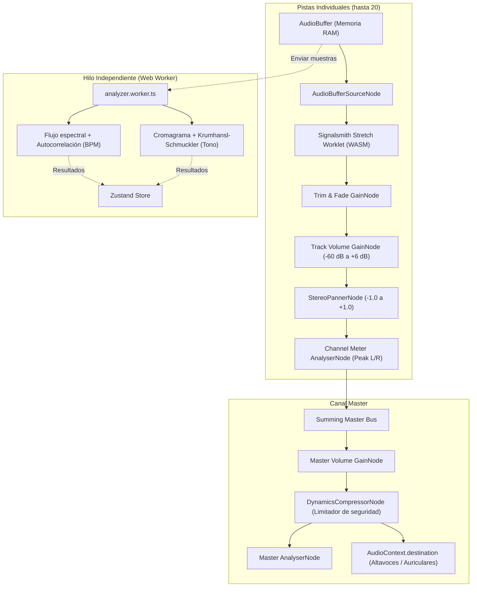

<p align="center">
  
</p>

<h1 align="center">OpenMT — Open Multitrack Audio Workstation</h1>

<p align="center">
  <strong>Estación de trabajo y reproductor de audio multipista profesional que se ejecuta 100 % en el navegador web.</strong><br />
  Procesamiento en tiempo real con Web Audio API, WebAssembly (WASM), Web Workers y Time-Stretch / Pitch-Shift de alta fidelidad.
</p>

<p align="center">
  
  
  
  
  
  
  
  
</p>

---

## 📖 Tabla de Contenidos

1. [Acerca de OpenMT](#-acerca-de-openmt)
2. [Características Principales](#-características-principales)
3. [Tecnologías Utilizadas](#-tecnologías-utilizadas)
4. [Arquitectura del Motor de Audio](#-arquitectura-del-motor-de-audio)
5. [Compatibilidad de Navegadores y Sistemas](#-compatibilidad-de-navegadores-y-sistemas)
6. [Instalación y Ejecución en Local](#-instalación-y-ejecución-en-local)
7. [Guía de Uso Paso a Paso](#-guía-de-uso-paso-a-paso)
8. [Letras Sincronizadas (LRC / OBS)](#-11-letras-sincronizadas-lrc-y-transmisión-en-vivo-para-obs-y-pantallas)
9. [Atajos de Teclado](#-atajos-de-teclado)
10. [Estructura del Proyecto](#-estructura-del-proyecto)
11. [Exportación y Renderizado](#-exportación-y-renderizado)
12. [Privacidad y Seguridad](#-privacidad-y-seguridad)
13. [Licencia y Créditos](#-licencia-y-créditos)

---

## 🎯 Acerca de OpenMT

**OpenMT** es una solución ligera, potente y moderna para la reproducción, mezcla, ensayo y manipulación de pistas de audio multipista (*stems* o *multitracks*). Diseñada para músicos, directores de alabanza, ingenieros de mezcla y productores que necesitan cambiar el tono, alterar la velocidad, ensayar por secciones y reproducir secuencias multipista sin depender de DAWs pesados de escritorio ni de servicios en la nube con suscripciones.

> [!IMPORTANT]
> **Privacidad Absoluta (100 % en tu equipo):** Todos los archivos de audio se procesan, decodifican, analizan y renderizan directamente en la memoria RAM de tu navegador web. Ningún archivo ni dato personal sale de tu equipo hacia servidores externos.

---

## 🚀 Características Principales

### 🎚️ 1. Motor Multipista Profesional (hasta 20 pistas)
- **Capacidad ampliada:** Carga y reproduce de forma sincronizada hasta **20 pistas estéreo simultáneas**.
- **Amplio soporte de formatos:** Compatible con `WAV`, `MP3`, `FLAC`, `OGG`, `M4A`, `AAC`, `Opus` y más.
- **Tira de canal completa por pista:**
  - Fader de volumen analógico calibrado de `-60 dB` a `+6 dB` con tope de ganancia unitaria en `0 dB` (doble clic para volver a 0 dB).
  - Control de balance estéreo (Pan `-100 % L` a `+100 % R`) con **efecto imán en el centro** (snapping magnético automático a `C`), indicador visual (`C`, `L50`, `R25`) y restablecimiento a centro con **doble clic**.
  - Botones dedicados de **Mute (M)** y **Solo (S)** con lógica excluyente inteligente.
  - Indicadores de nivel estéreo independientes (L/R) renderizados en `<canvas>` a **60 fps** con memoria de pico (*peak-hold*) y advertencia de saturación (*clipping*).

### ⚡ 2. Time-Stretching y Pitch-Shifting en Tiempo Real
- Impulsado por el algoritmo de última generación **Signalsmith Stretch** compilado en **WebAssembly (WASM)** y ejecutado en un nodo de **AudioWorklet**.
- **Control de Tempo independiente:** Modifica la velocidad del 50 % al 200 % sin alterar la afinación musical.
- **Función Key Lock:** Alterna entre estiramiento temporal puro o simulación de velocidad variable tipo vinilo.
- **Corrección de octava:** Botones rápidos `÷2` y `×2` para compensar tempos detectados.
- **Transposición tonal:** Modifica el tono de `-12` a `+12 semitonos` con ajuste fino de microtonos de `-50` a `+50 cents`.
- **Rueda de Camelot integrada:** Visualiza y calcula la tonalidad resultante y su notación armónica (ej. `8B / C Mayor`).

### 🔒 3. Bloqueo de Tono por Pista (Pitch Lock)
- Permite seleccionar pistas específicas (como **batería**, **percusión**, **metrónomo/click** o **voz guía**) para **bloquearlas del cambio tonal general**.
- Al transponer la tonalidad maestra de la canción, las pistas bloqueadas permanecen en su afinación original para evitar artefactos o desafinaciones en elementos percusivos.
- Modal dedicado para gestionar rápidamente el bloqueo individual o por lotes.

### 🔁 4. Secciones de Canción y Transiciones en Cola (*Queued Jumps*)
- **Detección inteligente de secciones:** Identifica nombres comunes en pistas guía o marcadores (`Intro`, `Verso 1`, `Coro`, `Puente`, `Solo`, `Outro`).
- **Modo Bucle por Sección:** Repite indefinidamente la sección seleccionada para ensayos específicos.
- **Transiciones en cola sin cortes:** Haz clic en otra sección durante la reproducción y OpenMT la colocará en cola con un indicador visual, realizando el cambio **al final exacto de la sección actual** para mantener el compás musical.
- Botón de salto inmediato opcional para transiciones directas.

### 🔍 5. Timeline con Zoom Horizontal Interactivo
- Visualización de formas de onda dinámicas por pista.
- Controles de zoom horizontal en la esquina de la regla (`[-]`, `[100%]`, `[+]`).
- Atajos rápidos de zoom con rueda de ratón: `Ctrl + Rueda` o `Alt + Rueda`.
- Marcador de tiempo (*playhead*) con sincronización de sub-píxeles.

### ✂️ 6. Recorte de Clips y Desvanecimientos (Fade In / Fade Out)
- Edición no destructiva por pista con el editor de clips integrado.
- Ajuste de punto de inicio (*Start Offset*) y punto de final (*End Offset*).
- Desvanecimiento de entrada (*Fade In*) y desvanecimiento de salida (*Fade Out*) configurables en milisegundos con curvas lineales y visualización en la onda.

### ↩️ 7. Historial de Deshacer y Rehacer (Undo / Redo)
- Pila de historial integrada que registra cambios en faders, panorámicas, mutes, solos, tono, tempo, secciones y edición de clips.
- Atajos universales: `Ctrl + Z` (deshacer) y `Ctrl + Y` o `Ctrl + Shift + Z` (rehacer).

### 💾 8. Gestión de Proyectos y Reconexión Inteligente (*Smart Relink*)
- **Exportar e importar proyectos en JSON:** Guarda toda la sesión (nombre, volumen, pan, tono, tempo, secciones, bloqueos, recortes y zoom) en un archivo `.json` ligero.
- **Biblioteca de proyectos guardados:** Persistencia automática en el navegador con buscador en tiempo real, recarga, duplicado y eliminación.
- **Reconexión de archivos (Relink Modal):** Si mueves o renombras tus archivos de audio, OpenMT detecta las pistas faltantes y te permite reconectarlas archivo por archivo o mediante un selector de carpetas por lotes.

### 📤 9. Exportación de Audio Master (WAV y MP3)
- Renderizado fuera de línea acelerado (*offline render*) mediante `OfflineAudioContext`.
- Aplica fielmente todos los volúmenes, faders, panorámicas, silencios, time-stretch, transposición tonal, recortes y fundidos.
- **Formatos disponibles:**
  - **WAV:** Calidades PCM de 16 bits, 24 bits o 32 bits en coma flotante; frecuencia de muestreo de 44.1 kHz o 48 kHz.
  - **MP3:** Codificación local de alta velocidad con `@breezystack/lamejs` con tasas de bits seleccionables (128 kbps, 192 kbps, 256 kbps o 320 kbps).
- Barra de progreso interactiva en tiempo real y descarga directa.

### 🎨 10. Interfaz Adaptable y Estilizada
- **3 Temas de color profesionales:**
  - `Live Dark`: Fondo oscuro elegante inspirado en interfaces profesionales de estudio.
  - `Live Light`: Modo de alta visibilidad para ambientes luminosos.
  - `Live Neon`: Estética sintética de alto contraste con acentos cian y magenta.
- **Disposiciones flexibles de faders:** Vista de sesión (faders abajo) o vista de arreglo (faders a la izquierda de cada pista).
- **Tipografía local Figtree:** Tipografía moderna instalada en el paquete localmente, preservando números monoespaciados tabulares en relojes y medidores.
- **Cero emojis:** Iconografía vectorial profesional con `lucide-react`.

### 🎤 11. Letras Sincronizadas (LRC) y Transmisión en Vivo para OBS y Pantallas
- **Soporte de formato estándar LRC (.lrc / .txt):** Carga archivos de letra sincronizados o pégalos directamente con marcas de tiempo `[mm:ss.xx]`.
- **Ajuste fino de sincronización (Offset):** Adelanta o retrasa la letra (+/- 0.2s, +/- 1.0s) para sincronización milimétrica con la banda o secuencia.
- **Sincronización en tiempo real:** Comunicación instantánea con **BroadcastChannel API** y eventos de almacenamiento entre pestañas y aplicaciones.
- **Ventana emergente y enlace para OBS Studio:**
  - Abre un visor limpio e independiente o copia un enlace directo para una **Fuente de Navegador (Browser Source)** en OBS Studio (`?view=lyrics`).
  - **3 Modos de visualización:**
    - `Tercio inferior (Lower Third)`: 2 líneas al fondo con alto contraste y sombra nítida, diseñado para flotar sobre cámaras en vivo.
    - `Teleprompter`: Desplazamiento continuo que mantiene la línea activa centrada y destacada para músicos en escenario.
    - `Pantalla completa`: Modo proyector / auditorio tradicional con texto grande.
  - **4 Fondos seleccionables:** `Transparente` (nativo para OBS), `Oscuro elegante`, `Croma verde (#00FF00)` y `Negro puro`.
  - Controles flotantes con auto-ocultación automática para una captura 100 % limpia.
  - Se guarda automáticamente junto con tu proyecto en formato JSON o memoria local.

---

## 💻 Tecnologías Utilizadas

| Categoría | Tecnología / Librería | Versión | Propósito |
| :--- | :--- | :--- | :--- |
| **Núcleo UI** | [React](https://react.dev/) | `^19.3.1` | Biblioteca de interfaz reactiva y componentes modulares |
| **Lenguaje** | [TypeScript](https://www.typescriptlang.org/) | `~7.0.2` | Tipado estricto en toda la lógica de audio y UI |
| **Empaquetador** | [Vite](https://vitejs.dev/) | `^8.3.4` | Servidor de desarrollo ultrarrápido y construcción optimizada |
| **Estado Global** | [Zustand](https://zustand-demo.pmnd.rs/) | `^5.0.15` | Gestión de estado predecible, reactiva y de alto rendimiento |
| **Motor DSP** | [Signalsmith Stretch](https://signalsmith-audio.co.uk/code/stretch/) | `^1.3.2` | Time-stretching y pitch-shifting polifónico vía WebAssembly |
| **Audio Nativo** | [Web Audio API](https://developer.mozilla.org/es/docs/Web/API/Web_Audio_API) | Nativa | Grafo de nodos de audio, AudioWorklet y procesamiento estéreo |
| **Procesamiento Hilos**| [Web Workers](https://developer.mozilla.org/es/docs/Web/API/Web_Workers_API) | Nativa | Detección de BPM (autocorrelación) y tono (Krumhansl) en background |
| **Render Offline** | `OfflineAudioContext` | Nativa | Renderizado de exportación multipista a velocidad de CPU |
| **Codificación MP3** | [@breezystack/lamejs](https://github.com/breezystack/lamejs) | `^1.2.7` | Codificador MP3 puro en JavaScript/TypeScript sin servidores |
| **Iconografía** | [Lucide React](https://lucide.dev/) | `^1.59.0` | Íconos limpios en SVG (cero emojis) |
| **Tipografía** | [@fontsource/figtree](https://fontsource.org/fonts/figtree) | `^5.3.0` | Fuente Figtree empaquetada localmente (100 % libre de CDN) |
| **Testing** | [Vitest](https://vitest.dev/) | `^5.0.5` | Pruebas unitarias de matemáticas de dB, música y estado |
| **Linter** | [Oxlint](https://oxc.rs/) | `^1.88.0` | Análisis estático de código ultra veloz en Rust |

---

## 🔊 Arquitectura del Motor de Audio

El flujo de señal de OpenMT está diseñado para mantener latencia ultra-baja y una precisión perfecta en la sincronización de las pistas:



---

## 🌐 Compatibilidad de Navegadores y Sistemas

OpenMT funciona en cualquier sistema operativo moderno con un navegador compatible con **Web Audio API**, **WebAssembly** y **AudioWorklet**:

| Navegador | Versión Mínima | Soporte | Notas |
| :--- | :---: | :---: | :--- |
| **Google Chrome** | 90+ |  Total | Máximo rendimiento y soporte de WASM SIMD |
| **Microsoft Edge** | 90+ |  Total | Basado en Chromium, rendimiento idéntico a Chrome |
| **Mozilla Firefox** | 90+ |  Total | Soporte nativo completo para AudioWorklet |
| **Apple Safari** | 15.4+ |  Total | Compatible en macOS, iPadOS e iOS |
| **Brave / Opera / Vivaldi** | Recientes |  Total | Rendimiento óptimo en motores Chromium |
| **Navegadores Móviles** | Android / iOS |  Compatible | Requiere toque inicial para desbloquear el contexto de audio |

---

## 🛠️ Instalación y Ejecución en Local

### Prerrequisitos
- [Node.js](https://nodejs.org/) versión **18.0.0** o superior (recomendado 20+ LTS).
- Administrador de paquetes `npm` (incluido con Node.js), `pnpm` o `yarn`.

### 1. Clonar el repositorio
```bash
git clone https://github.com/tu-usuario/daw-mt.git
cd daw-mt
```

### 2. Instalar dependencias
```bash
npm install
```

### 3. Iniciar el servidor de desarrollo
```bash
npm run dev
```
Abre tu navegador en [http://localhost:5173/](http://localhost:5173/). El entorno cuenta con Hot Module Replacement (HMR) instantáneo.

### 4. Ejecutar pruebas unitarias
```bash
npm test
```

### 5. Verificar calidad de código (Linter)
```bash
npm run lint
```

### 6. Compilar para producción
```bash
npm run build
```
Generará la carpeta optimizada y minificada `dist/` lista para ser servida en cualquier servidor web estático o CDN.

### 7. Previsualizar la compilación de producción
```bash
npm run preview
```

---

## 🧭 Guía de Uso Paso a Paso

### 1. Importar Pistas
- Puedes arrastrar múltiples archivos de audio directamente al área central de la aplicación o hacer clic en el botón con el ícono **`+`** (**Abrir audio**).
- La aplicación cargará hasta 20 pistas simultáneamente y asignará nombres y colores automáticamente.
- En segundo plano, el Web Worker calculará el tempo (BPM) y la tonalidad sugerida.

### 2. Control del Transporte
- Presiona **Espacio** o el botón circular de reproducción para iniciar o pausar.
- Haz clic sobre cualquier punto de la regla de tiempo (*Ruler*) o sobre las formas de onda para posicionar el cabezal de reproducción.
- Presiona **Inicio (Home)** para regresar al segundo 0.

### 3. Ajuste de Tono y Tempo
- **Cambiar Tempo:** Usa el campo numérico de BPM o el deslizador de porcentaje. Haz doble clic en el deslizador para regresar al 100 %.
- **Transponer Tonalidad:** En el panel **TONALIDAD**, usa el control escalonado (`+` / `-`) para subir o bajar semitonos completos. Ajusta los centésimas en el deslizador fino si el audio original está desafinado unos cuantos cents.
- **Bloqueo de Pista:** Si no deseas que la batería o los clicks se transpongan, abre el modal de **Bloqueo** o presiona el ícono de candado en la pista correspondiente.

### 4. Creación y Reproducción de Secciones
- En la barra superior del timeline verás las secciones creadas (`Intro`, `Coro`, etc.).
- Si haces clic sobre una sección activa, activará el modo bucle para esa sección.
- Si haces clic sobre otra sección mientras reproduces, la sección se pondrá en estado **"EN COLA"** con un aviso flotante y saltará suavemente justo al completar la sección en curso.

### 5. Guardado y Carga de Proyectos
- Ve al menú superior **Archivo > Guardar proyecto (.json)** para descargar un archivo JSON con toda tu configuración.
- Para reabrirlo, ve a **Archivo > Cargar proyecto (.json)**. Si los archivos de audio se encuentran en la misma ubicación o carpeta, se cargarán de inmediato; en caso contrario, el modal de reconexión te permitirá seleccionarlos.
- También puedes gestionar tus proyectos directamente en la memoria local desde **Archivo > Administrar proyectos guardados**.

### 6. Exportación de la Mezcla
- Ve a **Archivo > Exportar mezcla (WAV / MP3)**.
- Selecciona el formato deseado, resolución y tasa de bits.
- Haz clic en **Iniciar exportación** y descarga el archivo procesado.

---

## ⌨️ Atajos de Teclado

| Atajo | Acción |
| :--- | :--- |
| <kbd>Espacio</kbd> | Reproducir / Pausar la mezcla |
| <kbd>Inicio</kbd> / <kbd>Home</kbd> | Volver al inicio de la pista (tiempo `0:00.0`) |
| <kbd>Ctrl</kbd> + <kbd>Z</kbd> | Deshacer la última acción |
| <kbd>Ctrl</kbd> + <kbd>Y</kbd> / <kbd>Ctrl</kbd> + <kbd>Shift</kbd> + <kbd>Z</kbd> | Rehacer la acción |
| <kbd>Ctrl</kbd> + <kbd>Rueda del ratón</kbd> | Acercar o alejar el zoom horizontal del timeline |
| <kbd>Alt</kbd> + <kbd>Rueda del ratón</kbd> | Acercar o alejar el zoom horizontal del timeline |
| <kbd>Doble Clic</kbd> en Faders / Sliders | Restablecer valor a su posición por defecto (`0 dB`, `0 cents`, `100 %`) |
| <kbd>Escape</kbd> | Cerrar cualquier modal o menú desplegable abierto |

---

## 📁 Estructura del Proyecto

```plaintext
daw-mt/
├── public/
│   ├── images/
│   │   ├── favicon.png          # Favicon oficial
│   │   ├── logo-dark.png        # Logo para tema oscuro y neon
│   │   └── logo-light.png       # Logo para tema claro
│   └── favicon.ico
├── src/
│   ├── assets/                  # Gráficos auxiliares
│   ├── audio/
│   │   ├── analysis/
│   │   │   ├── analyzer.worker.ts # Web Worker para detección de BPM y Tono
│   │   │   ├── analyzerClient.ts  # Cliente de comunicación con el Worker
│   │   │   ├── dsp.ts             # Funciones de procesamiento de señales
│   │   │   └── fft.ts             # Algoritmo de transformada rápida de Fourier
│   │   ├── export/
│   │   │   └── exportMix.ts       # Render offline en WAV y MP3 con LameJS
│   │   ├── dbMath.ts              # Curvas logarítmicas de faders analógicos
│   │   ├── engine.ts              # Motor maestro de audio (Web Audio API)
│   │   ├── frameLoop.ts           # Bucle RAF unificado a 60 fps
│   │   ├── levels.ts              # Medición de picos estéreo y clipping
│   │   ├── music.ts               # Rueda de Camelot, escalas y transposición
│   │   ├── peaks.ts               # Extracción de picos para ondas visuales
│   │   ├── sync.ts                # Algoritmos de sincronización de transporte
│   │   └── track.ts               # Lógica individual de nodo por pista
│   ├── components/
│   │   ├── ClipEditorModal.tsx    # Modal de recorte y fades
│   │   ├── EmptyState.tsx         # Pantalla inicial de bienvenida y carga
│   │   ├── ExportModal.tsx        # Modal de exportación WAV / MP3
│   │   ├── Fader.tsx              # Componente de fader analógico interactivo
│   │   ├── KeyPanel.tsx           # Panel de tonalidad y bloqueo
│   │   ├── Lane.tsx               # Pista visual individual en el timeline
│   │   ├── MasterStrip.tsx        # Fader del canal Master
│   │   ├── MenuBar.tsx            # Barra superior de menús (Archivo, Edición, etc.)
│   │   ├── Meter.tsx              # Medidor estéreo en canvas
│   │   ├── MixerBottom.tsx        # Mezclador en vista inferior (Session)
│   │   ├── MixerStrip.tsx         # Tira de canal de pista individual
│   │   ├── PitchLockModal.tsx     # Modal de gestión de pistas bloqueadas
│   │   ├── RelinkModal.tsx        # Modal de búsqueda y reconexión de audios
│   │   ├── Ruler.tsx              # Regla de tiempo con marcas de compás y segundos
│   │   ├── SavedProjectsModal.tsx # Administrador de biblioteca de proyectos
│   │   ├── SectionsBar.tsx        # Barra de secciones de canción y bucles
│   │   ├── Stage.tsx              # Contenedor principal de pistas
│   │   ├── TempoPanel.tsx         # Panel de control de tempo y BPM
│   │   └── TopBar.tsx             # Barra de controles, transporte e historial
│   ├── hooks/
│   │   ├── useHotkeys.ts          # Manejador central de atajos de teclado
│   │   └── useMediaQuery.ts       # Detección de pantallas y responsividad
│   ├── store/
│   │   ├── derived.ts             # Selectores derivados optimizados
│   │   └── useDaw.ts              # Store global Zustand con pila de historial
│   ├── styles/
│   │   ├── app.css                # Estilos globales y componentes
│   │   └── tokens.css             # Variables CSS y paletas para los 3 temas
│   ├── types/
│   │   └── project.ts             # Definiciones TypeScript de proyectos y pistas
│   ├── utils/
│   │   └── projectManager.ts      # Serialización JSON y almacenamiento local
│   ├── App.tsx                    # Componente raíz
│   └── main.tsx                   # Punto de entrada de la aplicación
├── package.json
├── tsconfig.json
├── vercel.json                    # Cabeceras de seguridad CSP para producción
└── vite.config.ts
```

---

## 🔒 Privacidad y Seguridad

OpenMT está diseñado bajo la filosofía **Zero-Knowledge / Privacy-First**:
- **Sin cuentas ni registros:** Puedes usar la aplicación completa sin registrarte ni entregar correos electrónicos.
- **Sin telemetría ni rastreadores:** No se incluyen scripts de analíticas ni bibliotecas de terceros que espíen tus sesiones.
- **Cabeceras de Seguridad CSP:** El archivo `vercel.json` implementa políticas estrictas de seguridad de contenido (`Content-Security-Policy`):
  ```http
  Content-Security-Policy: default-src 'self'; script-src 'self' 'wasm-unsafe-eval' blob:; worker-src 'self' blob:; media-src 'self' blob: data:;
  ```
  Esto autoriza el uso de WebAssembly y Web Workers locales bloqueando cualquier inyección o conexión externa maliciosa.

---

## 📄 Licencia y Créditos

Este proyecto es de código abierto.

### Reconocimientos especiales:
- **[Signalsmith Audio](https://signalsmith-audio.co.uk/):** Por el excepcional algoritmo de estiramiento de audio y cambio de tono [Signalsmith Stretch](https://github.com/Signalsmith-Audio/signalsmith-stretch).
- **[Lucide Icons](https://lucide.dev/):** Por el completo set de íconos vectoriales.
- **[LameJS](https://github.com/breezystack/lamejs):** Por la implementación de codificación MP3 en JavaScript.
- **[Google Fonts / Fontsource](https://fontsource.org/):** Por la tipografía Figtree.

---

<p align="center">
  Desarrollado con dedicación para músicos y creadores de audio. Si encuentras útil este proyecto, ¡no dudes en darle una ⭐ en GitHub!
</p>
